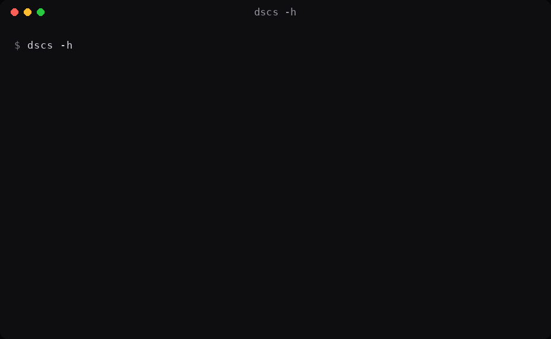
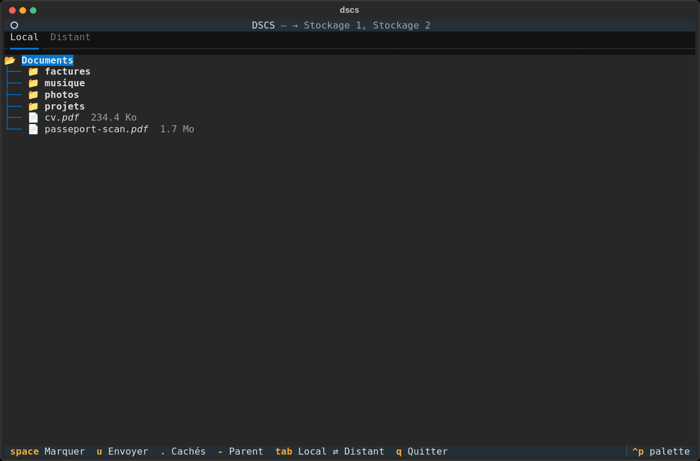
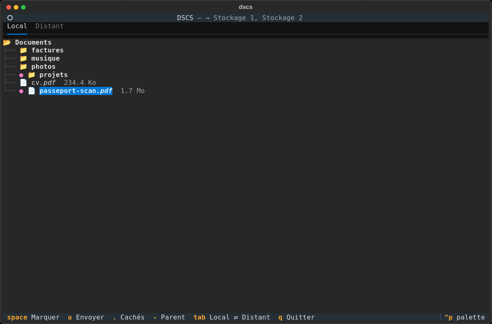
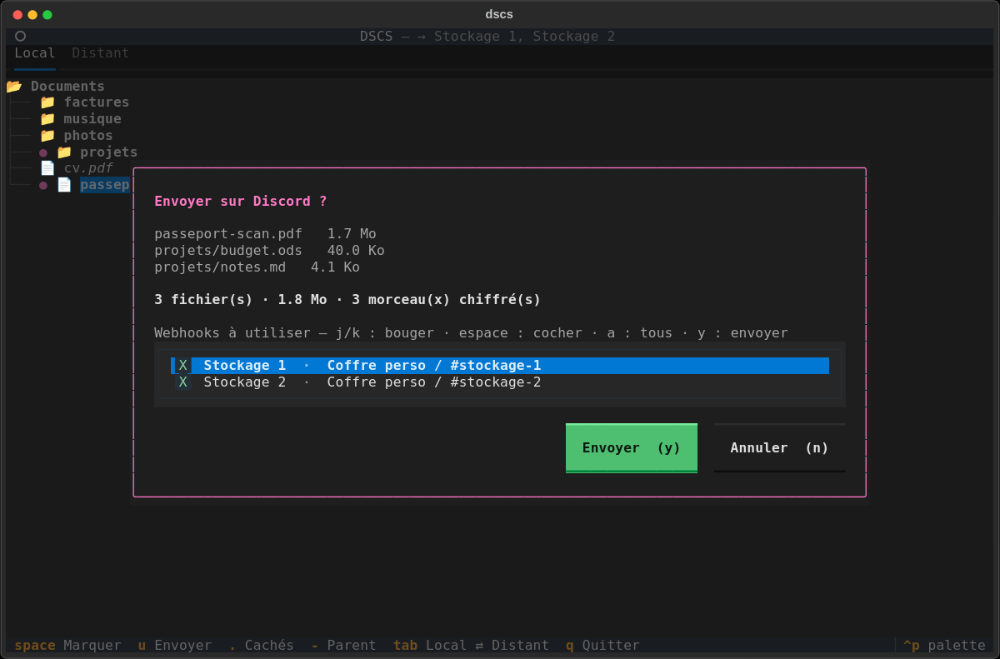
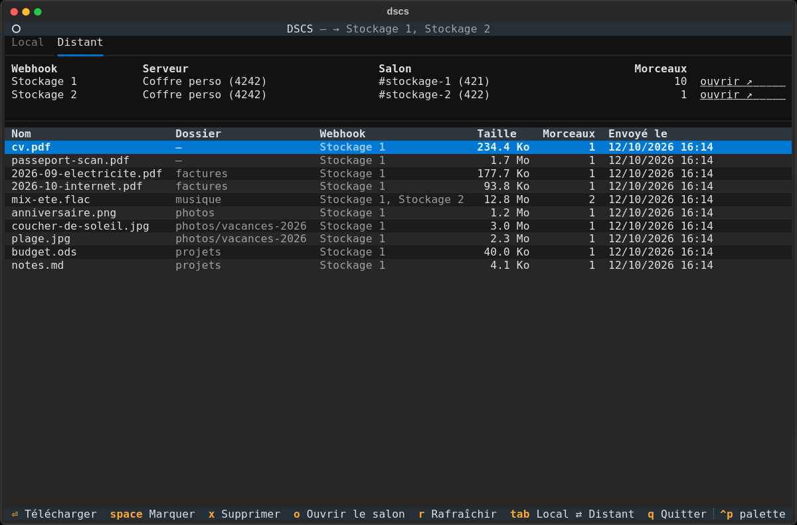
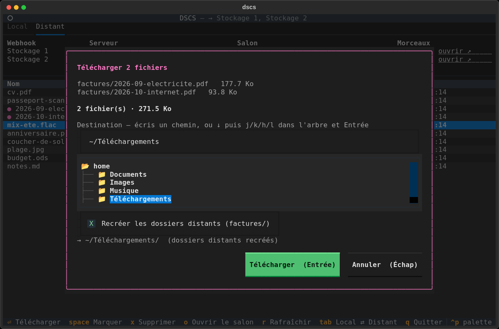
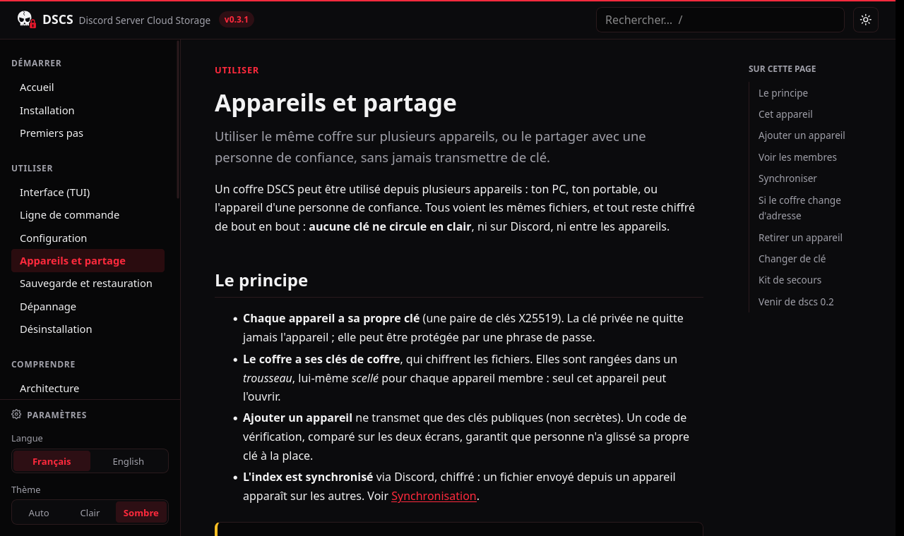

<p align="center">
  
</p>

# DSCS — Discord Server Cloud Storage

Stockage chiffré de bout en bout sur un serveur Discord, piloté depuis le terminal : arbre de fichiers navigable
façon vim, confirmation, puis envoi par webhooks. Un même coffre peut être partagé entre plusieurs appareils, sans
jamais transmettre de clé en clair.

- Documentation complète (locale) : `make docs` puis <http://localhost:8080>
- Architecture technique : [ARCHITECTURE.md](ARCHITECTURE.md)

## Aperçu

<p align="center">
  
</p>

| | |
|---|---|
|  |  |
| **Onglet Local** — arbre façon vim, `espace` marque fichiers et dossiers | **Envoi** — choix des webhooks (salons) qui reçoivent les morceaux chiffrés |
|  |  |
| **Onglet Distant** — fichiers stockés, serveur et salon de chaque webhook | **Téléchargement** — destination écrite ou choisie dans l'arbre avec `h j k l` |

<p align="center">
  <br>
  <sub>La documentation locale (PHP + SCSS, français / anglais), thème noir et rouge.</sub>
</p>

<sub>Captures générées par `make media` contre le faux serveur Discord des tests : aucune donnée réelle.</sub>

## Installation

```bash
pipx install .        # ou : pip install --user .
dscs init             # colle l'URL du webhook (un ou plusieurs)
dscs ~/Documents      # lance l'interface sur ce dossier
```

Pour créer le webhook : paramètres du salon → **Intégrations** → **Webhooks** → **Nouveau webhook** →
**Copier l'URL**. Plusieurs webhooks, un par salon, permettent d'envoyer en parallèle.

## Touches

| Onglet Local | | Onglet Distant | |
|---|---|---|---|
| `j` `k` / `↑` `↓` | bouger | `j` `k` | bouger |
| `l` / `→` | déplier / entrer | `Entrée` / `l` | télécharger (la sélection) |
| `h` / `←` | replier / remonter | `x` | supprimer de Discord (la sélection) |
| `g` `G` | haut / bas | `r` | rafraîchir |
| `espace` | marquer (fichier ou dossier) | `espace` | marquer (plusieurs fichiers) |
| `u` | envoyer la sélection | `o` | ouvrir le salon dans Discord |
| | | `Tab` | changer d'onglet |
| `Entrée` | envoyer le fichier (ou la sélection) | `q` | quitter |
| `.` | afficher les fichiers cachés | | |
| `-` / `~` | dossier parent / home | | |

À l'envoi, l'écran de confirmation liste les webhooks : `j` `k` pour bouger, `espace` pour cocher, puis `y` / `n`.
Au téléchargement, écris le dossier de destination, ou `↓` puis `h j k l` dans l'arbre, puis `Entrée`. Dans toutes
les fenêtres, `h` `j` `k` `l` passent aussi d'un bouton à l'autre. Pendant un transfert, `c` annule ; les morceaux déjà envoyés
sont alors supprimés de Discord.

## Sans interface

```bash
dscs put fichier.iso dossier/   # envoyer (-w NOM : seulement sur ce webhook, répétable)
dscs ls                         # lister (avec les ID)
dscs get 12 -o ~/Bureau         # récupérer (--flat : sans recréer le dossier distant)
dscs rm 12                      # supprimer de Discord (-y : sans confirmation)
dscs gc                         # nettoyer les envois interrompus
dscs webhooks                   # webhooks du coffre : serveur, salon, lien
```

## Plusieurs appareils, chiffrement de bout en bout

Chaque appareil a sa propre clé (jamais transmise) ; la clé du coffre lui est remise scellée, et l'index est
synchronisé, chiffré, via Discord. Rien de secret ne circule en clair.

```bash
dscs device init                    # nouvel appareil : affiche sa clé publique et son code
dscs device add <clé publique>      # sur un appareil membre : vérifie le code, donne une invitation
dscs device join <invitation>       # sur le nouvel appareil : vérifie le code de l'autre, rejoint le coffre
dscs device list | revoke <nom>     # membres, retrait d'un appareil (nouvelle génération de clé)
dscs device passphrase              # protéger la clé de cet appareil par une phrase de passe
dscs key rotate | recovery          # nouvelle clé de coffre, kit de secours (à garder hors ligne)
dscs sync                           # synchronisation (aussi faite automatiquement)
dscs sync --repair                  # recréer le point d'entrée du coffre (webhook déplacé), puis :
dscs device invite                  #   invitation à jour, pour « dscs device join » sur les autres appareils
```

## Ne jamais perdre l'accès

| Fichier | Rôle |
|---|---|
| `~/.config/dscs/device.json` | La clé de cet appareil (chiffrée si phrase de passe). Elle ouvre le trousseau. |
| `~/.config/dscs/keyring.sealed` | Le trousseau du coffre, scellé pour cet appareil (aussi publié sur Discord, scellé pour chaque membre). |
| `~/.config/dscs/config.toml` | Réglages, webhooks ajoutés à la main, noms lisibles des serveurs et salons. |
| `~/.local/share/dscs/index.db` | Copie locale de l'index (l'index partagé est publié chiffré sur Discord). |

Si tu perds l'accès sur **tous** tes appareils, le coffre est illisible : crée un kit de secours
(`dscs key recovery`) et range-le hors ligne, ou ajoute un deuxième appareil.

Ne supprime jamais dans Discord un webhook (ou un salon) déjà utilisé, et ne déplace pas un webhook vers un autre
salon : un webhook ne retrouve ses messages que dans son salon actuel. Pour un nouveau salon, crée un nouveau webhook.

## Depuis les versions précédentes

- **0.2** : l'ancienne clé en clair (`~/.config/dscs/key`) est transférée dans le trousseau de l'appareil au premier
  lancement, puis effacée. Ajoute ensuite une phrase de passe et crée un kit de secours.
- **0.1** : l'index est migré automatiquement (les tokens de webhook n'y sont plus stockés).
- Si tu avais lancé l'ancien `dstore init`, renomme `~/.config/dstore` et `~/.local/share/dstore` en `dscs`.

## Limites

- Utiliser Discord comme stockage n'est pas un usage prévu par ses conditions d'utilisation : le compte ou le
  serveur peut être banni. Ne mets jamais là ta seule copie de quoi que ce soit.
- Quiconque a l'URL d'un webhook peut poster et supprimer ses messages : garde-la privée.
- `chunk_size_mb` peut monter jusqu'à 499, mais la limite qui s'applique à un webhook est celle du **serveur**
  (niveau de boost), pas forcément celle de ton Nitro : vérifie-la avant d'augmenter.

## Désinstaller complètement

Dans cet ordre (la clé et l'index servent à retrouver ce qu'il faut supprimer) :

```bash
# 1. récupérer ce que tu veux garder
dscs ls | awk '$4 ~ /^[0-9]+\/[0-9]+\/[0-9]+$/ {print $1}' | xargs -r -n1 dscs get -o ~/recuperation
# 2. effacer tes données de Discord (ou supprimer les salons de stockage dans Discord)
dscs ls | awk '$4 ~ /^[0-9]+\/[0-9]+\/[0-9]+$/ {print $1}' | xargs -r -n1 dscs rm -y
dscs gc
# 3. supprimer les webhooks dans Discord : salon → Intégrations → Webhooks → Supprimer
# 4. désinstaller le programme
pipx uninstall dscs            # ou : pip uninstall dscs
# 5. supprimer les fichiers locaux
shred -u ~/.config/dscs/device.json ~/.config/dscs/keyring.sealed
rm -rf ~/.config/dscs ~/.local/share/dscs
```

Détails (XDG, `DSCS_HOME`, dossier de téléchargement, environnement de dev) : page « Désinstallation » de la doc.

## Développement

```bash
make install   # .venv + dépendances de dev
make test      # pytest (faux serveur Discord : 429, liens expirés, limite 10 Mio, TUI pilotée)
make lint      # ruff
make docs      # documentation locale (PHP) sur http://localhost:8080
```
