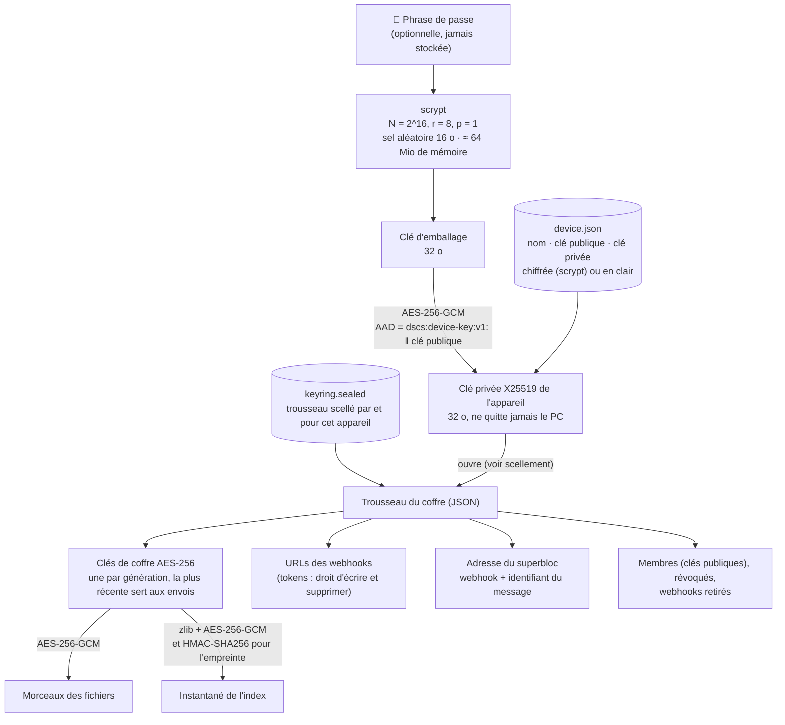
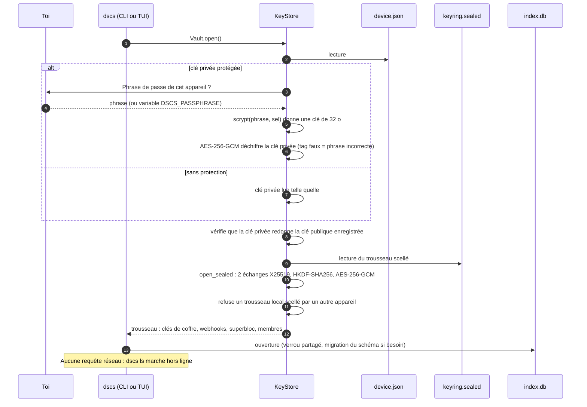
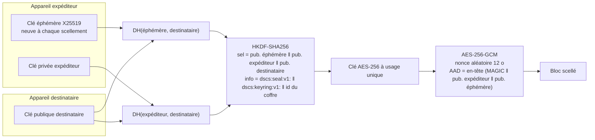
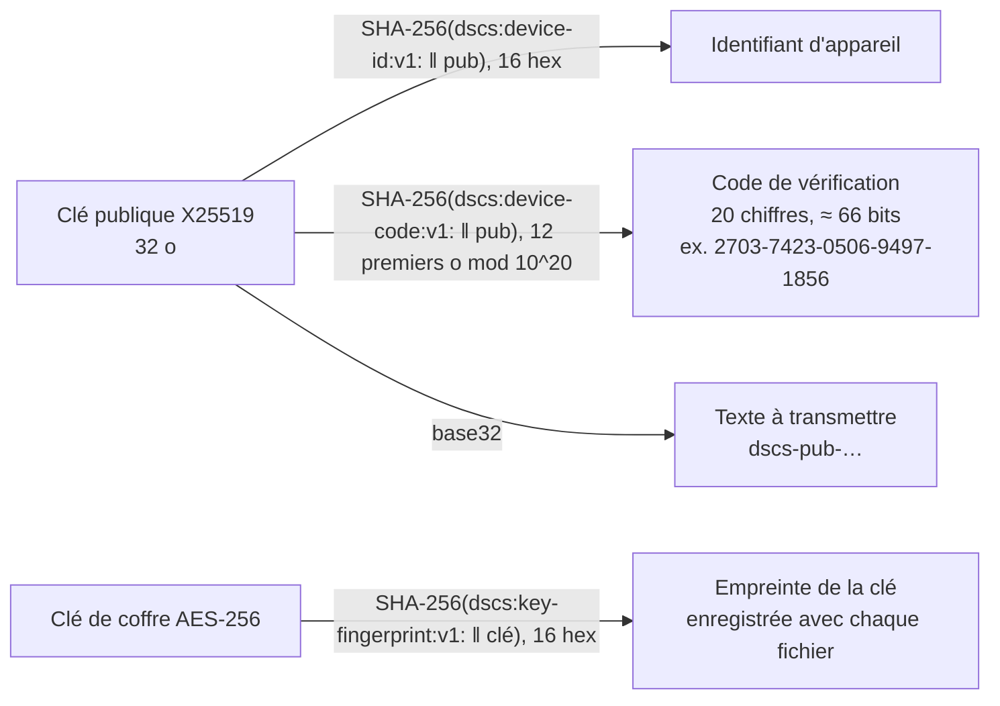

# 1. Clés et secrets

[← Vue d'ensemble](README.md) · Code : `crypto/device.py`, `crypto/sealing.py`, `crypto/keyring.py`,
`crypto/keys.py`, `services/keystore.py`

Trois niveaux de clés : la **phrase de passe** (optionnelle) protège la **clé de l'appareil**, qui ouvre le
**trousseau du coffre**, qui contient les **clés de coffre** qui chiffrent les fichiers. Aucune clé n'est jamais écrite
ni envoyée en clair.

## Hiérarchie des clés

Sans phrase de passe, la clé privée est dans `device.json` en clair, protégée seulement par les droits `600` du
fichier : `dscs device passphrase` l'ajoute à tout moment.

## Ouverture du coffre (au lancement de chaque commande)

## Scellement d'un trousseau pour un appareil

Utilisé pour `keyring.sealed` (scellé par l'appareil pour lui-même) et dans le superbloc (un exemplaire par appareil
membre). Dans l'esprit de HPKE en mode authentifié.

| Octets | Contenu |
|---|---|
| id du coffre ‖ `\n` | en clair, pour le contexte (vérifié après ouverture) |
| 8 | `DSCSSL01` (MAGIC) |
| 32 | clé publique de l'expéditeur |
| 32 | clé publique éphémère |
| 12 | nonce |
| n | trousseau chiffré (JSON) |
| 16 | tag GCM |

- **Confidentialité** : seul le détenteur de la clé privée du destinataire recalcule les deux échanges DH.
- **Authenticité** : seul le détenteur de la clé privée de l'expéditeur a pu calculer DH(expéditeur, destinataire).
  L'appelant vérifie ensuite que cet expéditeur est un membre de confiance (voir [Synchronisation](4-synchronisation.md#confiance)).
- **Contexte** : un bloc scellé pour un usage ou un coffre ne s'ouvre pas pour un autre.

## Identifiants dérivés (publics)

L'empreinte de clé dit quelle génération a chiffré un fichier sans permettre de retrouver la clé ; le code de
vérification se compare entre deux écrans pour déjouer une substitution de clé publique (voir
[Appareils](5-appareils.md)).
