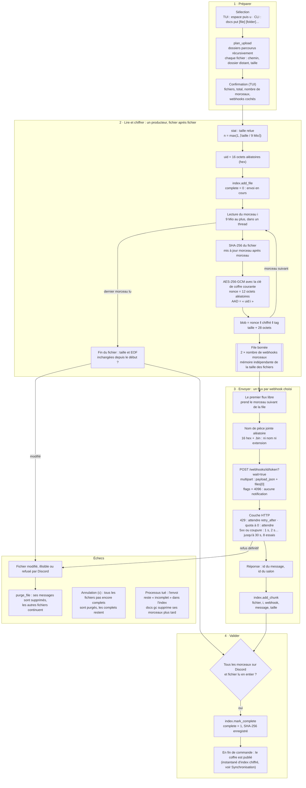
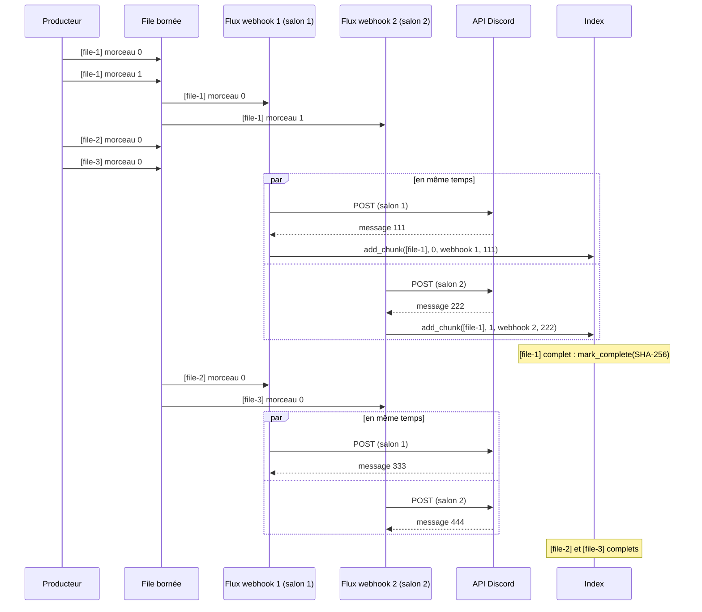
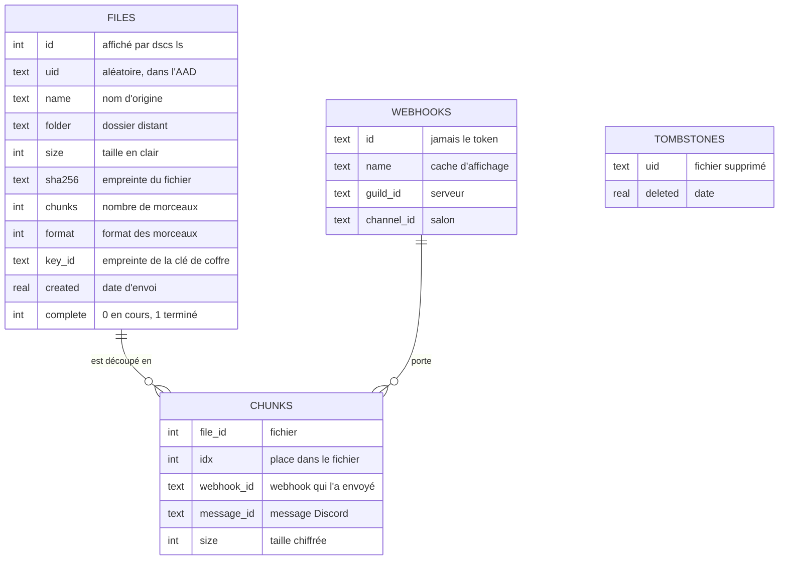

# 2. Envoi : du disque à Discord

[← Vue d'ensemble](README.md) · Code : `transfer/plan.py`, `transfer/upload.py`, `crypto/cipher.py`,
`discord/webhook.py`, `discord/http.py`, `index/repository.py`, `services/vault.py` (`upload_many`)

## Le pipeline complet



## Un morceau, tel qu'il part sur Discord

| Octets | Contenu |
|---|---|
| 12 | nonce aléatoire (jamais réutilisé avec la même clé) |
| ≤ 9 Mio | données chiffrées en AES-256-GCM (clé de coffre courante, 256 bits) |
| 16 | tag d'authentification GCM |

- **AAD = `uid:idx`** : le tag lie le morceau à *son* fichier (uid aléatoire) et à *sa* place. Un morceau modifié,
  déplacé dans le fichier ou transplanté dans un autre fichier ne se déchiffre pas.
- **Format 1** (`CHUNK_FORMAT`), enregistré avec chaque fichier : un futur format restera reconnaissable.
- Taille par défaut **9 Mio** (`chunk_size_mb`) : Discord refuse plus de 10 Mio par pièce jointe sur un serveur
  sans boost.

La requête vers Discord :

```text
POST https://discord.com/api/webhooks/<id>/<token>?wait=true
Content-Type: multipart/form-data
  payload_json = {"content": "", "flags": 4096, "attachments": [{"id": 0, "filename": "a3f91c5e0b7d2e84.bin"}]}
  files[0]     = <nonce ‖ chiffré ‖ tag>                      (application/octet-stream)
→ 200 {"id": "<message>", "channel_id": "<salon>", "attachments": [{"url": "https://cdn.discordapp.com/…"}]}
```

`wait=true` fait renvoyer le message créé : son identifiant est ce qui permettra de le relire et de le supprimer.

## Parallélisme : tous les webhooks travaillent en même temps

Les morceaux de tous les fichiers passent par la même file ; chaque webhook a son flux et prend le morceau suivant dès
qu'il est libre. Un petit fichier (un seul morceau) part donc sur le premier webhook libre, un gros fichier se répartit
sur tous, et il n'y a pas de pause entre deux fichiers. Exemple avec 2 webhooks et 3 fichiers :



Discord limite le nombre de messages **par salon** : ce sont des webhooks dans des **salons différents** qui
additionnent les débits. `dscs bench` mesure ce que donne chaque salon.

## Ce que l'index retient d'un envoi



L'index ne contient **aucun secret** : ni clé, ni token de webhook. Il est publié chiffré pour les autres appareils
(voir [Synchronisation](4-synchronisation.md)).
