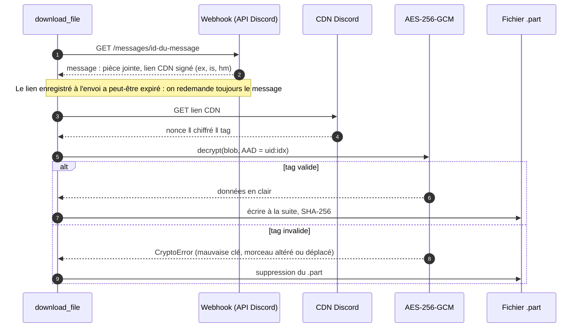

# 3. Téléchargement : de Discord au disque

[← Vue d'ensemble](README.md) · Code : `transfer/download.py`, `crypto/cipher.py`, `discord/webhook.py`,
`utils/fs.py` (`safe_join`, `unique_path`), `services/vault.py` (`download`)

## Le pipeline complet

```mermaid
flowchart TD
    subgraph CHOOSE["1 · Choisir"]
        PICK["Onglet Distant : espace marque, Entrée ou l<br/>CLI : dscs get [id] -o [folder]"]
        DEST["Destination<br/>écrite, ou choisie dans l'arbre (h j k l)<br/>dossier distant recréé ou non"]
        PICK --> DEST
    end

    subgraph KEY["2 · Retrouver la bonne clé"]
        KID["key_id du fichier (empreinte enregistrée à l'envoi)<br/>sinon la clé courante"]
        HAS{"Cette génération de clé<br/>est dans le trousseau ?"}
        NOKEY["Refus avant tout téléchargement :<br/>clé absente du trousseau de cet appareil"]
        KID --> HAS
        HAS -->|"non"| NOKEY
    end

    subgraph CHECKS["3 · Vérifications avant d'écrire"]
        FMT["Format des morceaux connu ?"]
        COUNT["L'index connaît tous les morceaux ?<br/>(n trouvés = n attendus)"]
        HOOKS["Chaque webhook de ces morceaux<br/>est dans le coffre ?"]
        TARGET["Chemin final = safe_join(destination, dossier, nom)<br/>refuse tout chemin qui sortirait de la destination"]
        UNIQUE["unique_path : jamais d'écrasement<br/>nom.ext existe : nom (1).ext"]
        PART["Écriture dans nom.ext.part"]
        FMT --> COUNT --> HOOKS --> TARGET --> UNIQUE --> PART
    end

    subgraph FETCH["4 · Récupérer et déchiffrer, dans l'ordre"]
        PRE["3 morceaux préchargés en avance<br/>pendant que le précédent est déchiffré"]
        MSG["GET /webhooks/id/token/messages/message<br/>pour obtenir un lien CDN frais"]
        CDN["GET sur le CDN<br/>(liens signés, expirent après ~24 h)"]
        DEC["AES-256-GCM : déchiffrement<br/>nonce = 12 premiers octets<br/>AAD = « uid:idx »"]
        TAG{"Tag GCM valide ?"}
        WRITE["Écriture à la suite dans le .part<br/>SHA-256 mis à jour"]
        PRE --> MSG --> CDN --> DEC --> TAG
        TAG -->|"oui"| WRITE
        WRITE -->|"morceau suivant"| PRE
    end

    subgraph VALID["5 · Valider"]
        SHA{"SHA-256 du fichier<br/>= celui enregistré à l'envoi ?"}
        RENAME["Renommage .part en nom final"]
        OK["📂 Fichier reconstitué"]
        BAD["Erreur d'intégrité :<br/>le .part est supprimé"]
        SHA -->|"oui"| RENAME --> OK
        SHA -->|"non"| BAD
    end

    DEST --> KID
    HAS -->|"oui"| FMT
    PART --> PRE
    TAG -->|"non : morceau altéré,<br/>déplacé ou d'un autre fichier"| BAD
    WRITE -->|"dernier morceau"| SHA
```

Un échec, une annulation ou une coupure suppriment le `.part` : il ne reste jamais de fichier à moitié écrit sous le
nom final.

## Un morceau, côté réseau

Seule la lecture du message passe par le webhook (et compte dans ses limites de débit) ; les octets viennent du CDN.
Un webhook **déplacé dans un autre salon** ne retrouve plus les messages restés dans l'ancien : le téléchargement
répond alors « message introuvable » (voir [Discord et sécurité](6-discord-et-securite.md)).
