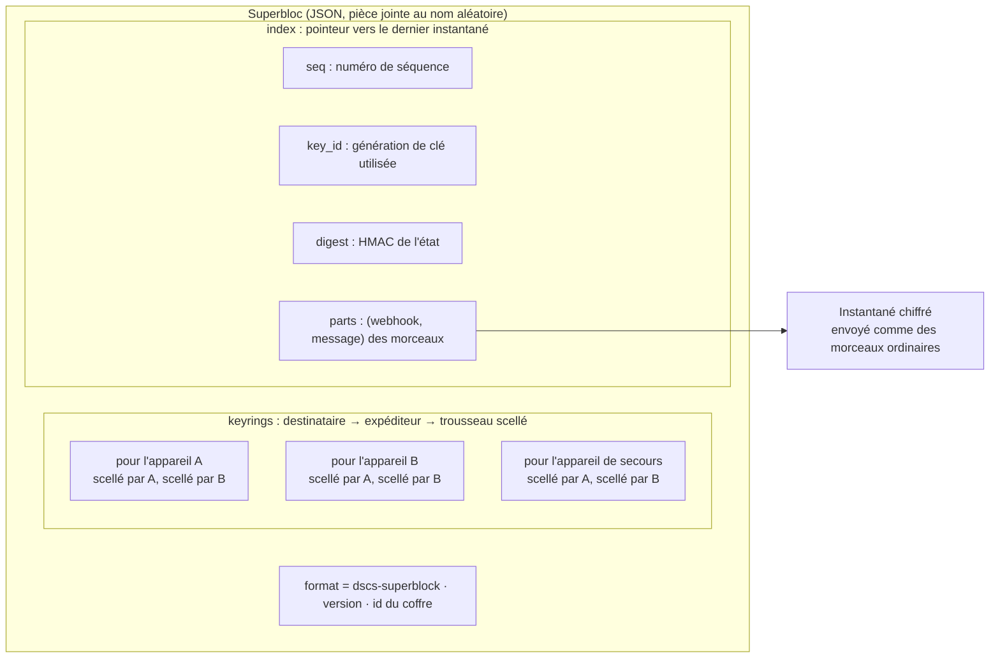
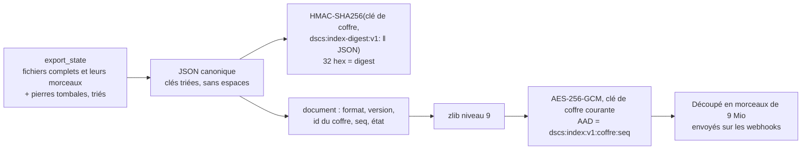
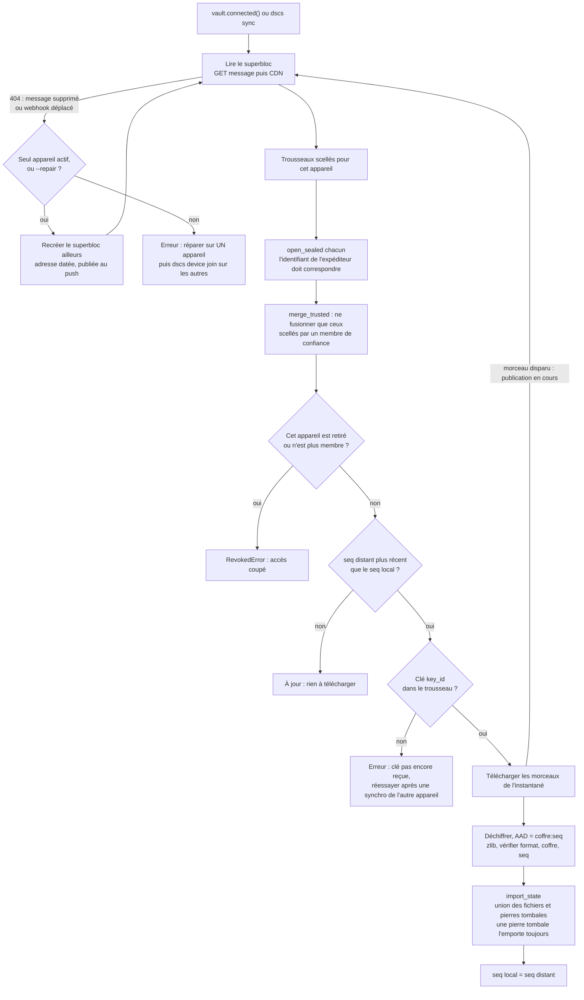
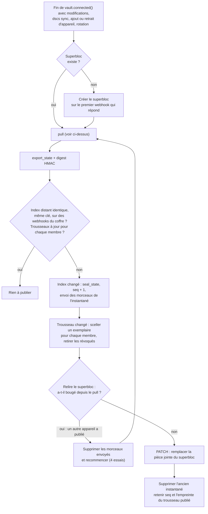
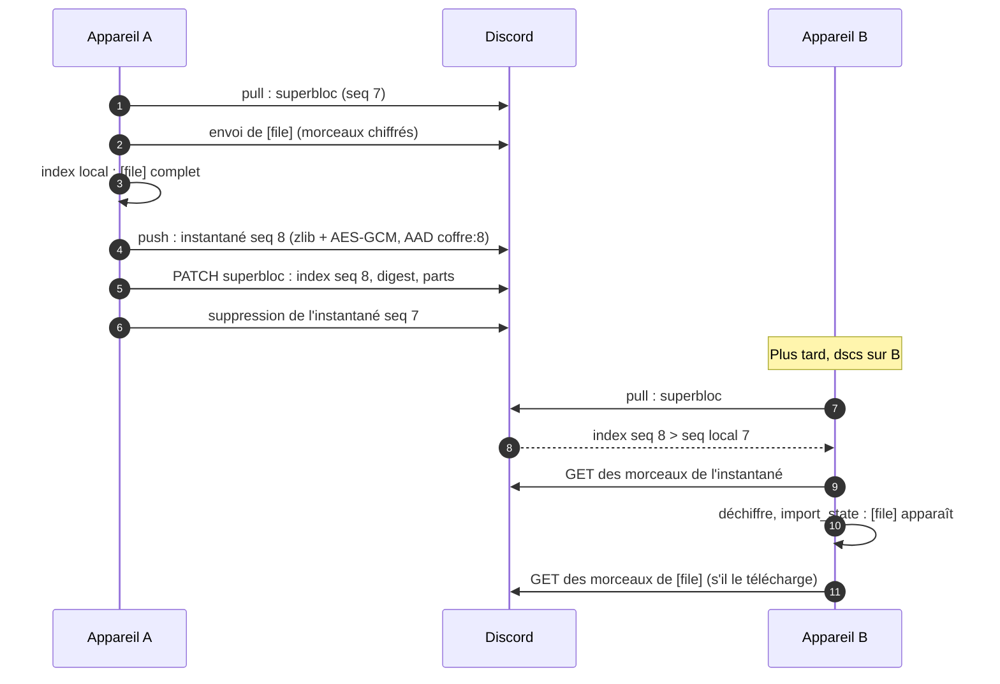
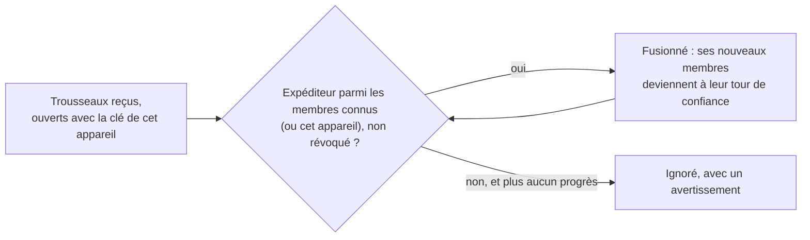

# 4. Synchronisation entre appareils

[← Vue d'ensemble](README.md) · Code : `sync/superblock.py`, `sync/snapshot.py`, `sync/engine.py`,
`index/repository.py` (`export_state`, `import_state`), `crypto/keyring.py` (`merge`)

Un webhook ne peut pas lister un salon : il faut un **point d'entrée connu**, le *superbloc*. C'est un message fixe
dont la pièce jointe est remplacée (`PATCH`) à chaque publication. Son adresse (webhook + identifiant du message) est
dans le trousseau et dans les invitations.

## Ce que contient le superbloc

Rien n'y est lisible sans clé : chaque trousseau n'est ouvrable que par son destinataire, et le pointeur ne dit que
*où* est l'instantané, pas ce qu'il contient.

## L'instantané de l'index

- Le **digest** permet de voir « rien de neuf » sans rien télécharger, sans révéler le contenu à qui n'a pas la clé.
- Le **numéro de séquence** est dans l'AAD : un vieil instantané ne peut pas être présenté comme récent.
- Les fichiers **incomplets** (envoi ou suppression en cours) ne sont jamais partagés.

## Recevoir (pull) : au début de chaque connexion

## Publier (push) : en fin de commande s'il y a eu des changements

Concurrence optimiste : un appareil ne publie jamais par-dessus un état distant qu'il n'a pas lu et fusionné. Deux
appareils qui publient en même temps : le second recommence avec l'état du premier, rien n'est perdu.

## Deux appareils, de bout en bout

## Fusion sans conflit

| Donnée | Règle de fusion |
|---|---|
| Fichiers | union par `uid` |
| Suppressions | union des pierres tombales ; une pierre tombale l'emporte sur le fichier |
| Clés de coffre | union ; la courante est la plus récente |
| Membres | union ; une révocation l'emporte |
| Webhooks | union ; un webhook retiré l'est partout et ne revient pas |
| Adresse du superbloc | la plus récente (une adresse recréée est datée) |

Le résultat ne dépend pas de l'ordre des fusions.

## Confiance

Un appareil révoqué ne peut ni se ré-ajouter ni injecter de clé ; un trousseau forgé par un tiers qui connaît un
webhook est ignoré. Au premier contact, c'est la comparaison des codes de vérification qui crée la confiance (voir
[Appareils](5-appareils.md)).
