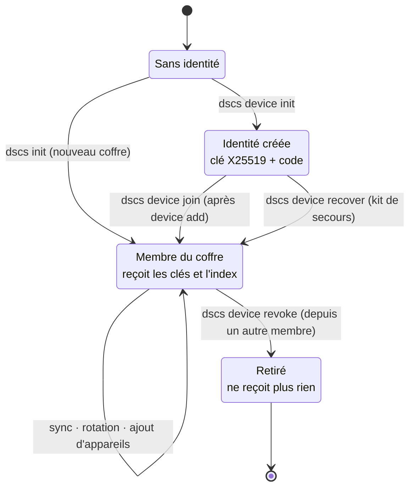
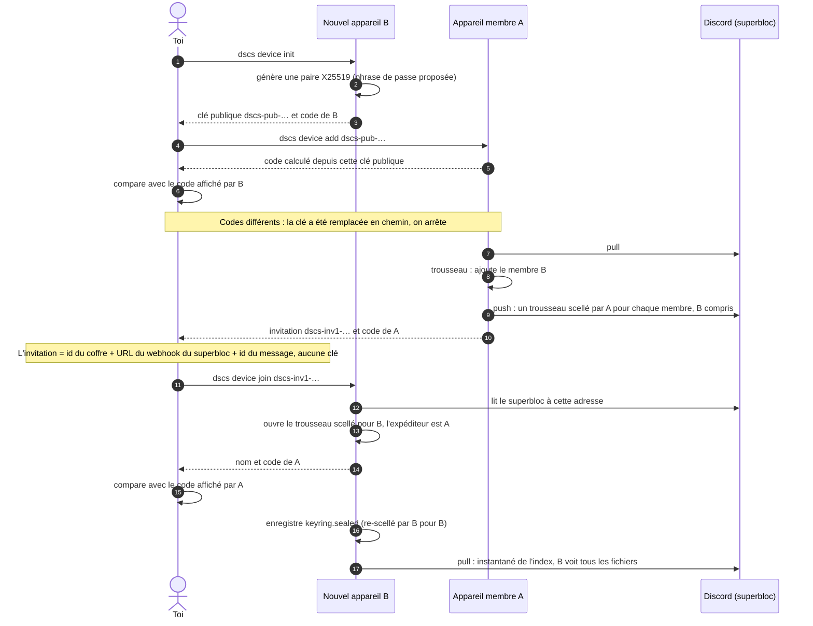
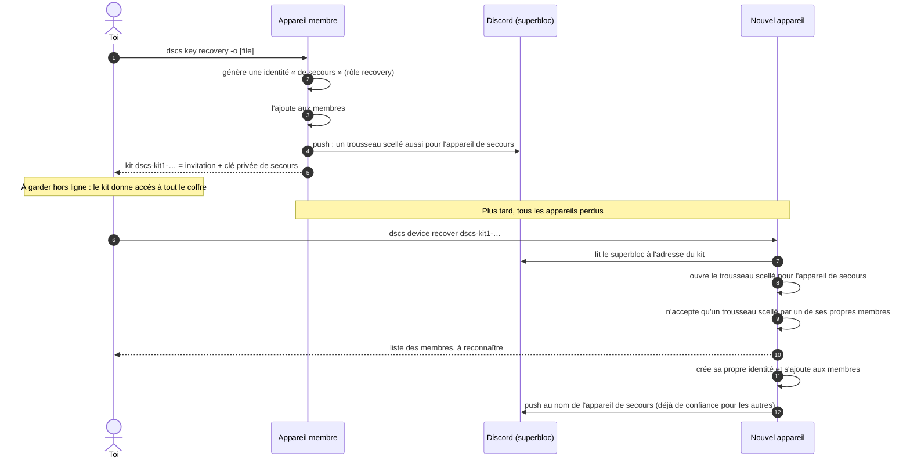
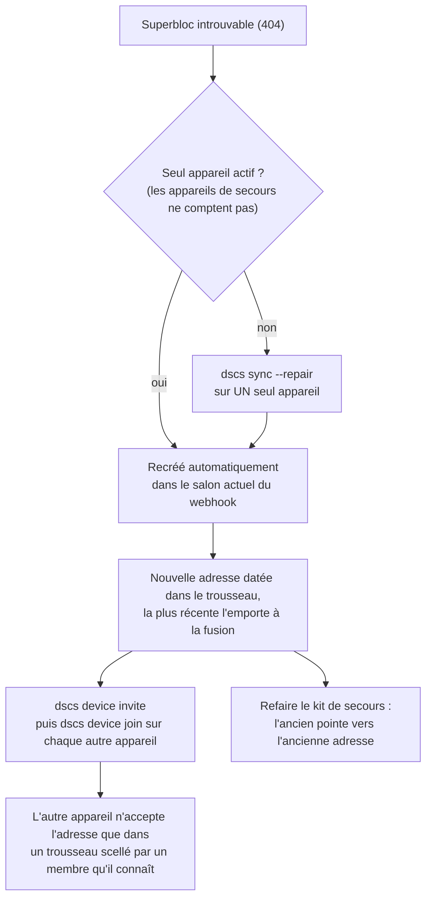
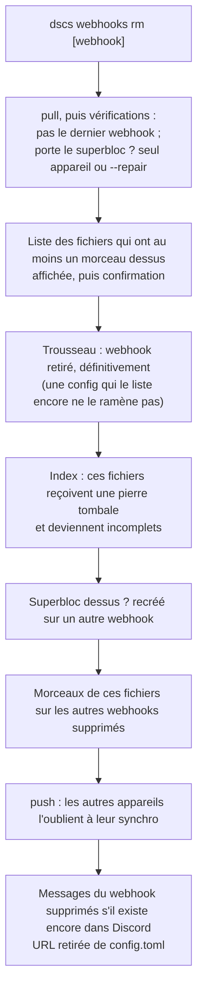

# 5. Appareils : appairage, révocation, rotation, secours

[← Vue d'ensemble](README.md) · Code : `services/devices.py`, `services/vault.py`, `crypto/keyring.py`,
`sync/invitation.py`, `cli/commands.py` (`device`, `key`)

## Cycle de vie d'un appareil

## Appairage : aucune clé secrète ne circule

La double comparaison des codes empêche quiconque de glisser sa propre clé publique à la place de celle de B, ou de
se faire passer pour A. L'invitation donne seulement l'*adresse* du coffre : sans être membre, on n'y lit rien.
Elle contient pourtant l'URL d'un webhook (droit d'écrire et de supprimer) : à transmettre par un canal privé.

## Révocation et rotation

```mermaid
flowchart TD
    subgraph REVOKE["dscs device revoke B (sur A)"]
        R1["pull"] --> R2["B sort des membres<br/>et entre dans les révoqués"]
        R2 --> R3["Nouvelle génération de clé de coffre<br/>(rotation automatique)"]
        R3 --> R4["push : trousseau scellé pour les membres restants<br/>les exemplaires pour B sont retirés"]
        R4 --> R5["B, à sa prochaine synchro :<br/>plus de trousseau pour lui, accès coupé"]
    end
    subgraph ROTATE["dscs key rotate"]
        K1["Nouvelle clé AES-256<br/>devient la clé courante"] --> K2["Anciennes clés gardées :<br/>les fichiers déjà envoyés restent lisibles"]
        K2 --> K3["push : tous les membres la reçoivent"]
        K3 --> K4["Les prochains envois l'utilisent<br/>(key_id enregistré par fichier)"]
    end
```

Limites assumées : un appareil retiré garde ce qu'il a déjà pu lire (anciennes clés, fichiers envoyés avant) et
connaît les URLs des webhooks, donc peut encore supprimer des messages. Ne partage le coffre qu'avec des appareils de
confiance.

## Kit de secours

## Réparer le point d'entrée du coffre

Un webhook déplacé dans un autre salon ne retrouve plus ses anciens messages, dont le superbloc.

## Retirer un webhook du coffre

