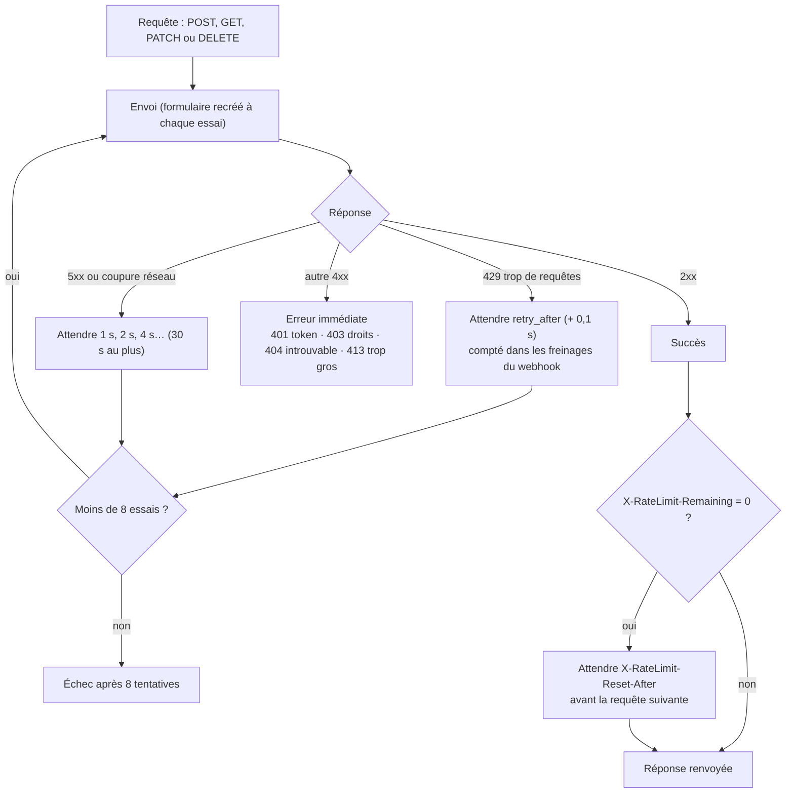
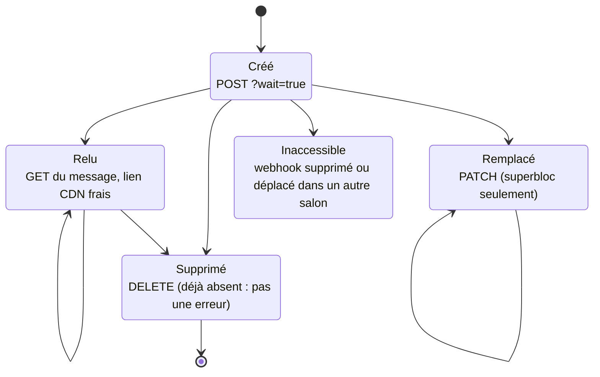
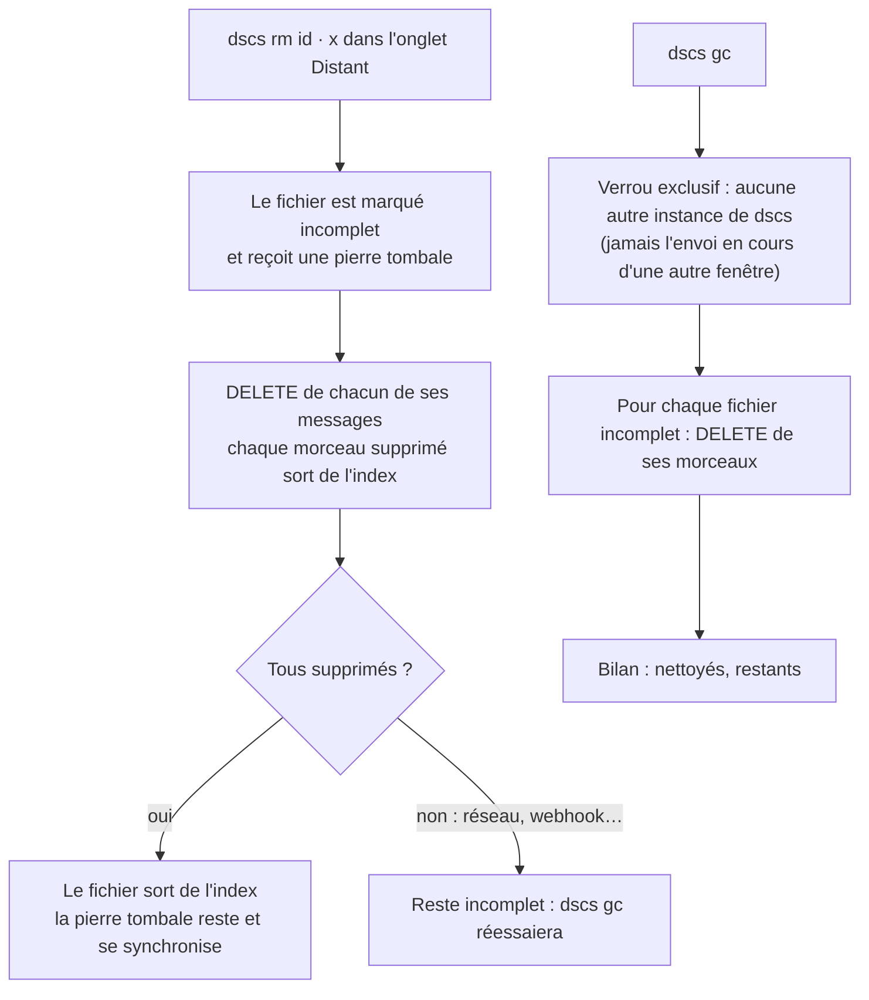

# 6. Discord et sécurité

[← Vue d'ensemble](README.md) · Code : `discord/http.py`, `discord/webhook.py`, `transfer/purge.py`,
`services/vault.py` (`delete`, `collect_garbage`), `index/lock.py`

## Une requête vers Discord

Toutes les requêtes passent par `discord.http.request` : session unique, en-tête `User-Agent` DSCS, connexion en
30 s maximum, lecture coupée après 180 s de silence.

Discord limite les requêtes **par webhook** et les messages **par salon**. dscs ne cherche pas à contourner ces
limites : il les respecte et répartit le travail sur plusieurs webhooks dans des salons différents.

## Cycle de vie d'un message

Un webhook ne peut relire, remplacer et supprimer **que ses propres messages, dans son salon actuel**. Ne jamais
supprimer ni déplacer un webhook qui a servi : pour un nouveau salon, créer un nouveau webhook.

## Le journal (`-v`, `-vv`, `--log`)

Chaque étape ci-dessus peut être suivie : `-v` montre la synchronisation, chaque fichier, les freinages et les
nouvelles tentatives ; `-vv` chaque requête (méthode, route, code, durée) et chaque morceau. Les URLs y passent par
`utils.redact_secrets` : `…/webhooks/<id>/***`, liens CDN `…&hm=***`, et aucune clé n'est jamais écrite. Un filtre
applique le même masquage en dernier recours sur tout ce qui sort.

## Suppressions et nettoyage

Les envois interrompus (processus tué, coupure) laissent aussi des fichiers incomplets : leurs morceaux sont déjà
inscrits dans l'index au fur et à mesure, donc `dscs gc` sait toujours les retrouver.

## Ce que Discord voit, et ce qu'il ne voit pas

| Discord voit | Discord ne voit pas |
|---|---|
| Des messages sans texte, notifications coupées | Le nom, le dossier, le type des fichiers |
| Des pièces jointes `16 hex.bin` d'environ 9 Mio (la dernière plus petite) | Le contenu (AES-256-GCM) |
| Le nombre de morceaux, leur taille, leur date | Le nombre de fichiers ni le découpage (dans l'index, chiffré) |
| Les identifiants des webhooks et des salons | Les clés de coffre, les clés privées des appareils |
| Le superbloc et l'instantané, en blocs chiffrés ou scellés | La liste des fichiers, les membres en clair |

## Attaques et réponses

| Si quelqu'un (Discord ou un tiers qui a une URL de webhook)… | Ce qui se passe |
|---|---|
| modifie un morceau | tag GCM invalide : refusé au déchiffrement |
| déplace un morceau ou le met dans un autre fichier | AAD `uid:idx` différente : refusé |
| remet un vieil instantané de l'index | numéro de séquence plus petit que celui connu : ignoré |
| glisse un trousseau scellé par un appareil inconnu | ignoré, avec un avertissement |
| donne une fausse invitation à un appareil membre | ignorée : seule compte une adresse scellée par un membre connu |
| remplace la clé publique d'un nouvel appareil pendant l'appairage | codes de vérification différents : l'appairage s'arrête |
| supprime les messages | possible : DSCS ne protège pas la **disponibilité**, garde d'autres copies |
| bannit le compte ou le serveur | possible : stocker des fichiers ainsi sort de l'usage prévu de Discord |
