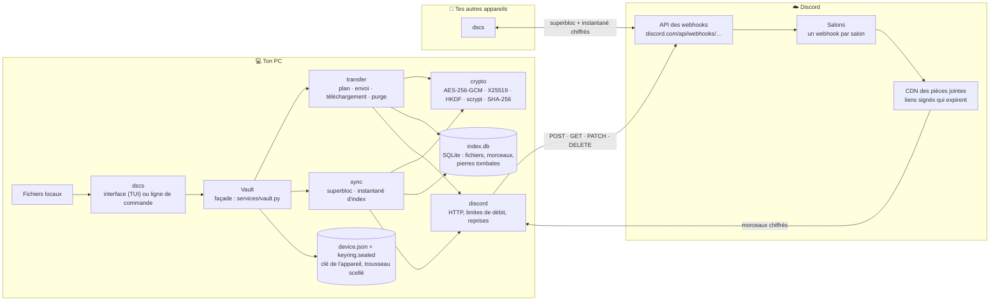
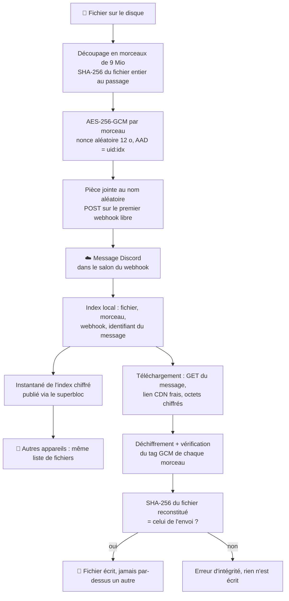

# Architecture de DSCS — schémas fonctionnels

Ce dossier montre **tout le chemin d'une donnée** : de ton PC jusqu'à Discord, en passant par la cryptographie et
chaque calcul, puis le retour jusqu'au fichier reconstitué. Chaque schéma suit le code réel (les noms de fonctions et
les constantes sont ceux de `src/dscs/`). GitHub affiche les diagrammes directement.

| Page | Ce qu'elle couvre |
|---|---|
| [1. Clés et secrets](1-cles.md) | Phrase de passe, scrypt, clé de l'appareil (X25519), trousseau scellé, clés de coffre AES-256, identifiants dérivés |
| [2. Envoi](2-envoi.md) | Du disque à Discord : plan, découpage, SHA-256, AES-256-GCM, file bornée, un flux par webhook, API, index |
| [3. Téléchargement](3-telechargement.md) | De Discord au disque : index, message, lien CDN frais, déchiffrement, vérification, écriture sans écraser |
| [4. Synchronisation](4-synchronisation.md) | Superbloc, instantané chiffré de l'index, réception et publication, fusion, confiance |
| [5. Appareils](5-appareils.md) | Appairage avec codes, révocation, rotation, kit de secours, réparation du superbloc, retrait d'un webhook |
| [6. Discord et sécurité](6-discord-et-securite.md) | Couche HTTP et limites de débit, cycle de vie des messages, suppressions, ce que Discord voit, attaques |

Référence textuelle : [ARCHITECTURE.md](../ARCHITECTURE.md). Documentation complète : `make docs`.

## Vue d'ensemble

**Règle de base** : rien ne sort du PC en clair. Discord ne reçoit que des pièces jointes chiffrées aux noms aléatoires
(`a3f91c…07.bin`) ; les noms de fichiers, les dossiers, les tailles exactes et toutes les clés restent chez toi, ou
voyagent chiffrés dans l'instantané d'index et le trousseau scellé.

## Ce qui vit où

| Élément | Où | Protection |
|---|---|---|
| Fichiers à envoyer, fichiers téléchargés | PC | aucune (ce sont tes fichiers) |
| `device.json` : clé privée X25519 de l'appareil | PC (`~/.config/dscs`) | droits `600`, et chiffrée par phrase de passe si tu en as une (scrypt + AES-256-GCM) |
| `keyring.sealed` : trousseau du coffre | PC | scellé pour cet appareil (X25519 + HKDF + AES-256-GCM) |
| `config.toml` : URLs des webhooks (tokens) | PC | droits `600` |
| `index.db` : noms, dossiers, tailles, SHA-256, où est chaque morceau | PC (`~/.local/share/dscs`) | droits `600`, aucun secret (ni clé, ni token) |
| Morceaux des fichiers | Discord | AES-256-GCM, AAD liant chaque morceau à son fichier et à sa place |
| Superbloc : trousseaux scellés + pointeur vers l'index | Discord | chaque trousseau scellé pour un seul appareil ; pointeur sans contenu lisible |
| Instantané de l'index | Discord | zlib puis AES-256-GCM, numéro de séquence authentifié |

## Les grandes étapes, en une image

